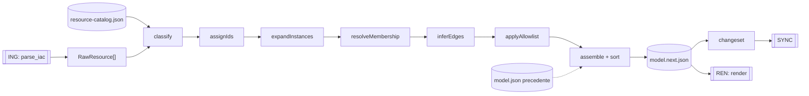

# Design: Architecture model

## Overview
MOD trasforma i `RawResource[]` di ING nel modello canonico. È l'unico stadio che conosce il catalogo dei tipi e le
regole di inferenza. Oggi lo esegue l'agente seguendo
`power/livearch/skills/architecture-diagrams/references/model-building.md` (Step 2–6), e lo verifica
`scripts/validate_architecture.py`. Con questa spec lo esegue il tool MCP `build_model`, con le stesse regole.

## Architecture



Codice:

```
power/livearch/skills/architecture-diagrams/scripts/changeset.py   # MOD-8, esiste
power/livearch/skills/architecture-diagrams/scripts/validate_architecture.py  # verifica MOD-1/2/3/5/6/7, esiste
power/livearch/mcp/src/model/{classify,ids,instances,membership,edges,allowlist,assemble,changeset}.ts  # nuovo
power/livearch/mcp/test/model/*.test.ts
```

## Components and interfaces

```ts
// src/model/types.ts — rispecchia model.schema.json, non lo ridefinisce
import type { RawResource, Warning, SourceFile, AdapterName } from "../ingest/types.js";

export type NodeKind = "compute" | "container" | "function" | "load-balancer" | "api-gateway" | "database" | "cache"
  | "object-storage" | "queue" | "topic" | "stream" | "cdn" | "dns" | "identity" | "secret" | "monitoring" | "external";
export type GroupKind = "account" | "region" | "network" | "subnet" | "environment" | "module";
export type EdgeKind = "network-flow" | "data-access" | "trigger" | "depends-on";

export interface Model { /* esattamente model.schema.json */ }
export interface Changeset {
  groups: { added: string[]; removed: string[]; changed: string[] };
  nodes:  { added: string[]; removed: string[]; changed: string[] };
  edges:  { added: string[]; removed: string[]; changed: string[] };
}

export type Classification =
  | { as: "node"; kind: NodeKind; provider: string; label: string; allow: string[] }
  | { as: "group"; kind: GroupKind; membership: string }
  | { as: "hidden" }
  | { as: "unmapped" };

export function classify(iacType: string, catalog: Catalog): Classification;            // MOD-2
export function sanitize(id: string): string;                                            // MOD-3
export function loadCatalog(json: unknown, rules: EdgeRuleRegistry): Catalog;            // MOD-6.9: UNKNOWN_EDGE_RULE
export function buildModel(input: BuildInput): Model;                                    // MOD-1..7, funzione pura
export function changeset(prev: Model | null, next: Model): Changeset;                   // MOD-8
export function summary(cs: Changeset): string[];                                        // ≤ 5 righe, MOD-8.2
```

Tool MCP:

| Tool | Input | Output | Effetti collaterali |
|------|-------|--------|---------------------|
| `build_model` | `{ resources: RawResource[], files: SourceFile[], adapters: AdapterName[], warnings: Warning[], commit: string \| null, previous?: Model }` | `{ model: Model, changeset: Changeset, summary: string[] }` | nessuno |
| `diff_models` | `{ previous: Model \| null, next: Model }` | `{ changeset: Changeset, summary: string[] }` | nessuno |

Il server non scrive file: il salvataggio di `model.next.json` e lo scambio con `model.json` sono di SYNC.

### Pipeline
1. **classify**: lookup esatto su `iacType` e `aliases` di `resources`, `groups`, `hidden`; solo dopo `hiddenPrefixes` (MOD-2.4).
2. **assignIds**: `id = address`; `diagramId` con `sanitize`; mappa inversa `diagramId → id` per rilevare collisioni (MOD-3.5).
3. **expandInstances**: soglia 3 (MOD-4).
4. **resolveMembership**: grafo dei riferimenti con le risorse nascoste come nodi intermedi; BFS dal nodo verso il
   primo gruppo raggiungibile, con priorità `subnet` > `network` e poi ordine di sorgente (`file`, `line`) (MOD-5).
5. **inferEdges**: grafo dei riferimenti con `collapsed(address)` che attraversa solo risorse nascoste (MOD-6.8);
   regole in ordine di priorità (`lb-listener`, `sg-ingress`, `event-source`/`subscription`, `data-access`,
   `depends-on`), poi deduplica per coppia (MOD-6.6). Ogni `edgeInference` del catalogo è un modulo
   `model/edges/<nome>.ts` registrato per nome: il catalogo dice *quale* regola, il codice *come* (MOD-6.9).
6. **applyAllowlist**: allowlist del catalogo + scarto dei valori redatti (MOD-7).
7. **assemble**: `generator`, `source`, ordinamento per `id`, `JSON.stringify(model, null, 2) + "\n"` con chiavi
   nell'ordine dello schema (MOD-1).

## Data models
- Modello: `power/livearch/skills/architecture-diagrams/references/model.schema.json` (normativo).
- Catalogo: `power/livearch/skills/architecture-diagrams/references/resource-catalog.json` (`resources`, `groups`,
  `hidden`, `hiddenPrefixes`, `kinds`, `edgeKinds`, `groupKinds`).
- Changeset: il JSON stampato da `scripts/changeset.py --json`.

## Error handling
| Situazione | Risultato | Requisito |
|------------|-----------|-----------|
| Tipo assente dal catalogo | nodo `external` + `UNMAPPED_TYPE` | MOD-2.5 |
| Due indirizzi → stesso `diagramId` | errore `DIAGRAM_ID_COLLISION`, nessun modello | MOD-3.5 |
| Ciclo o parent mancante | errore `INVALID_GROUP_TREE`, nessun modello | MOD-5.5 |
| `edgeInference` senza implementazione | errore `UNKNOWN_EDGE_RULE` al caricamento del catalogo | MOD-6.9 |
| Proprietà con valore redatto | proprietà scartata, nessun warning | MOD-7.2 |
| Warning da ING | copiati in `model.warnings[]` | MOD-7.3 |

`DIAGRAM_ID_COLLISION`, `INVALID_GROUP_TREE` e `UNKNOWN_EDGE_RULE` sono errori del tool, non codici di warning del modello: lo schema non cambia.

## Test strategy
- **Unit** (`node:test`): `classify` (esatto vs prefisso, alias CloudFormation), `sanitize`, soglia delle istanze,
  membership attraverso risorse nascoste, priorità degli edge, allowlist.
- **Golden**: `build_model(parse_iac("examples/aws-three-tier/terraform"))` deve essere identico byte per byte a
  `examples/aws-three-tier/docs/architecture/model.json` (MOD-9, chiude il test end-to-end citato da ING).
- **Proprietà**: per 50 permutazioni casuali (seed fisso) dell'ordine di `RawResource[]` il modello resta identico (MOD-1.4).
- **Changeset**: `changeset.py` su coppie di fixture (`add-queue`, `remove-db`, `rename-tag`): `rename-tag` deve dare
  `no architectural change` se il tag non è nell'allowlist. Per la parità (MOD-10.4) gli output di `changeset.py`
  vengono generati una volta e committati come file attesi, così che i test TypeScript non lancino Python.
- **Prestazioni**: `parse_iac` + `build_model` sulla fixture `perf-200` di ING, mediana di 5 esecuzioni ≤ 3 s (MOD-10.5).
- **Validatore**: ogni regola di MOD-1/2/3/5/6/7 ha un caso negativo che `validate_architecture.py` deve rifiutare.

## Decisions
- **D-MOD-1 · L'ID è l'indirizzo IaC.** È l'unica chiave che sopravvive a rinomina di tag, riordino dei file e cambio di
  label; senza, la geometria manuale di draw.io (REN-2) andrebbe persa a ogni sync.
- **D-MOD-2 · Un solo edge per coppia.** Più frecce tra gli stessi due box rendono il diagramma illeggibile; la
  priorità conserva l'informazione più forte.
- **D-MOD-3 · Allowlist, non denylist.** Un nuovo attributo sensibile di un provider non entra finché qualcuno non lo
  approva nel catalogo (vedi `.kiro/steering/security.md`).
- **D-MOD-4 · Il catalogo è l'unica fonte dei mapping.** Steering, spec e skill lo citano, non lo ricopiano; lo
  verifica l'hook `catalog-or-schema-changed`.

## Traceability
| Requisito | Componente | Test |
|-----------|------------|------|
| MOD-1 | `model/assemble.ts`, `validate_architecture.py` `check_model` | `assemble.test.ts`, `determinism.test.ts` |
| MOD-2 | `model/classify.ts` | `classify.test.ts` |
| MOD-3 | `model/ids.ts` | `ids.test.ts` |
| MOD-4 | `model/instances.ts` | `instances.test.ts` |
| MOD-5 | `model/membership.ts` | `membership.test.ts` |
| MOD-6 | `model/edges.ts` | `edges.test.ts` |
| MOD-7 | `model/allowlist.ts` | `allowlist.test.ts` |
| MOD-8 | `scripts/changeset.py`, `model/changeset.ts` | `changeset.test.ts` |
| MOD-9 | tutti | `golden.test.ts`, Stop gate |
| MOD-10 | `server.ts` | `server.test.ts` |
