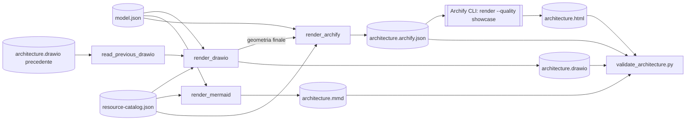

# Design: Diagram rendering

## Overview
I renderer sono funzioni pure `model → file`, con un'unica eccezione voluta: draw.io legge il file precedente per
conservare il lavoro umano. Archify riceve le posizioni da draw.io, quindi l'ordine è fisso:
draw.io → Mermaid → Archify IR → HTML. Oggi è tutto in `scripts/render.py` (Python standard library) e
`scripts/validate_architecture.py`; il server MCP li espone come tool senza cambiarne il comportamento.

## Architecture



## Components and interfaces

CLI (oggi):

```text
render.py <model.json> [out-dir] [--no-html]      # out-dir di default: la cartella del modello
validate_architecture.py <folder>                  # exit 0 = OK, 1 = FAIL
validate_architecture.py --catalog
```

Funzioni di `render.py`:

| Funzione | Ruolo | Requisiti |
|----------|-------|-----------|
| `Layout` (`_min_tier`, colonne) | auto-layout per tier, gruppi in ordine di traffico | REN-1.4 |
| `read_previous_drawio` | celle gestite (geometria, `livearch_style_hash`) e celle utente | REN-2.2–2.4, REN-2.6 |
| `render_drawio` | merge e cella `la__meta` | REN-2 |
| `render_mermaid` | `flowchart LR`, `subgraph`, frecce dal catalogo | REN-3 |
| `absolute_geometry` + `render_archify` | IR Archify con `pos`/`size` da draw.io, boundary non vuoti, card | REN-4.1–4.3, REN-4.7 |
| `find_archify` + `build_archify_html` | `$ARCHIFY_HOME`, poi `~/.kiro|.claude|.agents|.config/opencode/skills/archify` | REN-4.4–4.6 |

Tool MCP (futuro, TypeScript):

```ts
export interface RenderInput { root: string; modelPath: string; outDir?: string; html?: boolean }
export interface RenderResult { written: string[]; skipped: { file: string; reason: string }[] }
export interface ValidateResult { result: "OK" | "FAIL"; errors: string[]; warnings: string[]; summary: string | null }
// render_diagrams(RenderInput): RenderResult        — scrive solo in outDir, dentro root (PATH_OUTSIDE_ROOT)
// validate_diagrams({ root, folder }): ValidateResult
```

Il tool `render_diagrams` è l'unico del server che scrive file e lancia un processo figlio (la CLI di Archify, con
`execFile` e argomenti in array, senza shell): è dichiarato nel descrittore MCP e non apre connessioni di rete.

### Parità TypeScript ↔ Python (REN-7.2, REN-7.3)
- Costanti di layout (`NODE_W`, `COL_W`, `ROW_H`, `PAD`, `TOP`, `GAP`, `MIN_GROUP_W`, `MIN_GROUP_H`, `ORIGIN`) in un
  unico `layout-constants.ts`, con gli stessi valori di `render.py`.
- Serializzatore XML con lo stesso ordine degli attributi, gli stessi escape e la stessa indentazione di
  `xml.etree.ElementTree` + `ET.indent(space="  ")`.
- Numeri come li stampa Python (`str(int)`), SHA-256 sui byte UTF-8.
- Gli output attesi si generano una volta con gli script Python e si committano: i test TypeScript non eseguono Python.

### Scrittura atomica (REN-8)
Oggi `render.py` scrive i tre file prima di chiamare Archify, quindi un rifiuto di Archify lascia `.drawio`, `.mmd` e
`.archify.json` aggiornati e l'HTML vecchio. Con REN-8 tutti i file vanno in `<out>/.livearch-tmp/` e si spostano
con `os.replace` / `fs.rename` solo se tutto è riuscito. La cartella temporanea sta nella stessa cartella di output,
così che `rename` resti sullo stesso filesystem.

## Data models
- Input: `model.schema.json`. Stili: `resource-catalog.json`.
- draw.io: `references/drawio-format.md` (attributi `livearch_*`, cella `la__meta`, icone AWS).
- Mermaid: `references/mermaid-format.md`. Archify: `references/archify-format.md` (IR `schema_version: 1`).

## Error handling
| Situazione | Risultato | Requisito |
|------------|-----------|-----------|
| draw.io compresso o senza `mxGraphModel/root` | stop, nessun file scritto, messaggio con la procedura | REN-2.6 |
| Archify o Node.js assenti | tre file scritti, `skip architecture.html …`, `WARN` del validatore | REN-4.5, REN-5.4 |
| Archify rifiuta l'IR (edge sopra nodi, edge sui bordi) | exit ≠ 0 + diagnostica; nessun file cambia (REN-8); si corregge modello o layout | REN-4.6, REN-8.2 |
| Formati non allineati al modello | `ERROR <file>: missing …` / `… not in model` | REN-5.2 |
| Segreto in un output | `ERROR <file>: possible <tipo> at line N` | REN-5.3 |

## Test strategy
- **Golden**: lo Stop gate (`.kiro/hooks/scripts/stop_gate.py`) copia `examples/aws-three-tier/docs/architecture/`,
  rilancia `render.py` e confronta byte per byte (REN-1.2), poi lancia il validatore (REN-5).
- **Layout preservato**: fixture con una cella gestita spostata, uno stile modificato e una nota utente; dopo il
  render geometria, stile e nota sono invariati (REN-2.2–2.4); con un nodo rimosso dal modello la cella sparisce (REN-2.5).
- **Mutazioni per il validatore**: per ogni regola un file manomesso (cella mancante, freccia sbagliata, componente in
  più, account ID) che deve dare `RESULT: FAIL`.
- **Archify**: `archify finalize` sul golden (gate `validate`, `deliver`, `check`, `browser-check`); senza `ARCHIFY_HOME`
  e con `PATH` vuoto il render produce i tre file e il messaggio di skip.
- **Prestazioni**: fixture sintetica di 200 nodi / 300 edge, mediana di 5 esecuzioni con `--no-html` ≤ 2 s.

## Decisions
- **D-REN-1 · draw.io è l'unico formato modificabile.** È quello che le persone aprono e sistemano; Mermaid e Archify
  sono sempre rigenerati e quindi non possono divergere.
- **D-REN-2 · Archify eredita la geometria di draw.io.** Una sola fonte di layout: chi sposta un box lo fa una volta.
- **D-REN-3 · Python standard library per gli script.** Zero installazioni: il Power funziona offline anche senza il
  server MCP; Archify è opzionale e degrada a `WARN`.
- **D-REN-4 · Hash dello stile invece di un flag "modificato".** Rileva le modifiche manuali senza chiedere all'utente
  di marcare nulla.

## Traceability
| Requisito | Componente | Test |
|-----------|------------|------|
| REN-1 | `render.py` (`Layout`, header), catalogo | Stop gate (idempotenza), `determinism.test` |
| REN-2 | `read_previous_drawio`, `render_drawio` | fixture `drawio-manual-edits/` |
| REN-3 | `render_mermaid` | validatore `check_mermaid` |
| REN-4 | `render_archify`, `build_archify_html` | `archify finalize`, test senza CLI |
| REN-5 | `validate_architecture.py` | mutazioni, hook `validate-golden-example-on-save` |
| REN-6 | `render.py` | fixture `perf-200/` |
| REN-7 | `server.ts` (`render_diagrams`, `validate_diagrams`) | `server.test.ts`, `parity.test.ts` |
| REN-8 | `render.py` (staging), `render/atomic.ts` | `atomic.test.ts` |
