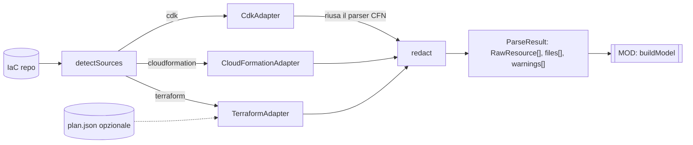

# Design: IaC ingestion

## Overview
Gli adapter sono la prima fase della pipeline `IaC → RawResource[] → model.json → diagrammi`. Trasformano un linguaggio
IaC in `RawResource[]` neutrali e redatti, e non sanno nulla di kind, gruppi, edge o formati: quella parte è di MOD.
Oggi questo passo lo fa l'agente seguendo `power/livearch/skills/architecture-diagrams/references/model-building.md`
(Step 1). Con questa spec lo fa il server MCP `livearch`, in modo deterministico.

## Architecture



Struttura del codice (server MCP, nuovo):

```
power/livearch/mcp/
├── package.json            # dipendenze pinnate, "type": "module", engines.node = 22
├── tsconfig.json           # strict, ES2022, NodeNext
├── src/
│   ├── server.ts           # registrazione dei tool MCP (stdio)
│   ├── fs/safe-path.ts     # risoluzione percorsi + PATH_OUTSIDE_ROOT
│   ├── ingest/detect.ts
│   ├── ingest/redact.ts
│   ├── ingest/terraform/{lexer,parser,static,plan}.ts
│   ├── ingest/cloudformation.ts
│   └── ingest/cdk.ts
└── test/ingest/*.test.ts   # node:test
power/livearch/mcp.json      # descrittore MCP del Power (command node, args dist/server.js)
```

## Components and interfaces

```ts
// src/ingest/types.ts
export type AdapterName = "cdk" | "cloudformation" | "terraform";
export type WarningCode =            // sottoinsieme di model.schema.json $defs.warning.code
  | "REMOTE_MODULE" | "UNRESOLVED_EXPRESSION" | "STALE_SYNTH" | "PARSE_ERROR";

export interface Warning { code: WarningCode; message: string; ref: string | null }

export interface Reference { to: string; via: string }      // via = attributo di origine, es. "vpc_id"

export interface RawResource {
  address: string;            // indirizzo Terraform o "<Stack>.<LogicalId>"
  iacType: string;            // "aws_sqs_queue" | "AWS::SQS::Queue"
  attributes: Record<string, AttrValue>;   // già redatti; chiavi speciali: __instances, __unresolved, __cdkPath
  references: Reference[];    // ordinati per (to, via), senza duplicati
  file: string;               // relativo alla root, con "/"
  line: number | null;
  module: string | null;      // "module.network" | "<Stack>.<LogicalId>" | null
  adapter: AdapterName;
}
export type AttrValue = string | number | boolean | null | AttrValue[] | { [k: string]: AttrValue };

export interface SourceFile { path: string; sha256: string }

export interface DetectResult {
  adapters: { name: AdapterName; files: string[]; status: "ready" | "needs-synth" }[];
  message?: "no IaC found";
}

export interface ParseResult {
  status: "ok" | "failed";
  adapters: AdapterName[];
  resources: RawResource[];   // [] se status = "failed" (ING-7.2)
  files: SourceFile[];        // ordinati per path
  warnings: Warning[];        // ordinati per (code, ref, message)
}

export interface Adapter {
  name: AdapterName;
  parse(root: string, files: string[], opts: { planJson?: string }): Promise<ParseResult>;
}
```

Tool MCP (input → output, JSON Schema derivato dai tipi sopra):

| Tool | Input | Output | Effetti collaterali |
|------|-------|--------|---------------------|
| `detect_sources` | `{ root: string }` | `DetectResult` | nessuno |
| `parse_iac` | `{ root: string, adapters?: AdapterName[], planJson?: string }` | `ParseResult` | nessuno |

### Terraform statico
- **Lexer/parser HCL scritto in casa** per il sottoinsieme che serve: blocchi (`resource`, `data`, `module`, `variable`,
  `locals`), attributi, blocchi annidati, heredoc, commenti `#`, `//`, `/* */`. Le espressioni non vengono valutate:
  si conservano come testo, tranne i letterali (stringhe senza interpolazione, numeri, bool, liste e mappe letterali).
- **Riferimenti**: dal testo di ogni espressione si estraggono i traversal `<tipo>.<nome>` e `module.<nome>.<output>`,
  risolti verso l'indirizzo della risorsa nello stesso modulo. I traversal `data.*` non sono risorse
  (`model-building.md` § Step 1) e vengono ignorati.
- **Moduli**: `source` locale → ricorsione con prefisso `module.<nome>.`; i riferimenti a `module.x.output` puntano
  alle risorse che l'output referenzia.
- `var.<nome>` si risolve solo se la variabile ha un `default` letterale e non è `sensitive` (ING-6.4).

### Terraform da piano
`planned_values.root_module` (e `child_modules`, ricorsivi) dà gli indirizzi con l'indice (`aws_subnet.public[0]`);
`configuration` dà i riferimenti (`expressions.*.references`). `sensitive_values` fa da maschera.

### CloudFormation / CDK
Parser JSON nativo; per lo YAML si usa la libreria `yaml` con custom tags per `!Ref`, `!GetAtt`, `!Sub`, `!ImportValue`,
`!Join`, `!Select`, `!If`, che vengono convertiti nella forma lunga prima dell'estrazione dei riferimenti. In `Fn::Sub`
i riferimenti sono i `${Name}` e `${Name.Attr}` che corrispondono a un LogicalId del template.

### Redazione
`redact(value, attrName)` si applica a ogni attributo prima che esca dall'adapter: prima il nome (ING-6.2), poi
la regex `\b\d{12}\b` → `<account>` (ING-6.3). È l'unico punto di redazione degli adapter; MOD aggiunge l'allowlist.

## Data models
- `RawResource`, `ParseResult`: questo documento, § Components and interfaces.
- `SourceFile` coincide con `source.files[]` di `power/livearch/skills/architecture-diagrams/references/model.schema.json`.
- I codici warning sono quelli di `model.schema.json` `$defs.warning.code`: non se ne aggiungono qui.

## Error handling
| Situazione | Risultato | Requisito |
|------------|-----------|-----------|
| File HCL/JSON/YAML non valido | `status: "failed"`, warning `PARSE_ERROR` `<file>:<linea>: <errore>` | ING-7.1, ING-7.2 |
| Modulo remoto | modulo vuoto + `REMOTE_MODULE` | ING-3.3 |
| Espressione non risolvibile | `attributes.__unresolved` + `UNRESOLVED_EXPRESSION` | ING-3.4 |
| `cdk.out/` assente | `status: "needs-synth"` in `detect_sources` | ING-5.5 |
| `cdk.out/` vecchio | prosegue + `STALE_SYNTH` | ING-5.6 |
| Percorso fuori dalla root | errore del tool `PATH_OUTSIDE_ROOT` (non è un warning del modello) | ING-8.2 |

## Test strategy
- **Unit** (`node:test`): lexer HCL (heredoc, commenti, interpolazioni), estrazione dei riferimenti, custom tags YAML,
  redazione (tabella di casi positivi e negativi).
- **Golden**: `parse_iac` su `examples/aws-three-tier/terraform` deve produrre le risorse da cui MOD ricava esattamente
  `examples/aws-three-tier/docs/architecture/model.json` (test end-to-end in MOD-9).
- **Fixture** in `power/livearch/mcp/test/fixtures/`: `tf-modules/` (modulo locale + remoto), `tf-plan/plan.json`,
  `cfn-yaml/` (forme brevi), `cdk-app/cdk.out/`, `broken/` (HCL non valido), `secrets/` (attributi e ARN da redigere),
  `perf-200/` (generata da uno script: 200 risorse in 20 file).
- **Prestazioni**: ING-3.6 si misura con `perf-200` su Node 22, la mediana di 5 esecuzioni dev'essere ≤ 2 s.
- **Sicurezza**: un test sostituisce `net.connect` e `child_process.spawn` con stub che falliscono e verifica che
  `detect_sources` e `parse_iac` vadano comunque a buon fine (ING-8.3).

## Decisions
- **D-ING-1 · Parser HCL in casa invece di una dipendenza.** Serve solo il sottoinsieme strutturale (blocchi e traversal),
  senza valutazione. Così non entrano binari WASM/Go e si rispetta "dipendenze minime e pinnate". Se servisse HCL
  completo, l'alternativa è `@cdktf/hcl2json`, di cui va verificato prima lo stato di manutenzione.
- **D-ING-2 · CDK solo da `cdk.out/`.** Lo dice `.kiro/steering/iac-sources.md`: il synth esegue codice dell'utente e
  serve una conferma, che chiede l'agente e non il server.
- **D-ING-3 · Redazione nell'adapter.** Se il segreto non entra mai in memoria oltre l'adapter, nessun renderer o
  log può farlo uscire. L'allowlist di MOD è una seconda difesa, non la prima.

## Traceability
| Requisito | Componente | Test |
|-----------|------------|------|
| ING-1 | `ingest/detect.ts` | `detect.test.ts` |
| ING-2 | `ingest/types.ts`, ordinamento in `server.ts` | `contract.test.ts` |
| ING-3 | `ingest/terraform/{lexer,parser,static}.ts` | `terraform-static.test.ts`, `perf.test.ts` |
| ING-4 | `ingest/terraform/plan.ts` | `terraform-plan.test.ts` |
| ING-5 | `ingest/cloudformation.ts`, `ingest/cdk.ts` | `cloudformation.test.ts`, `cdk.test.ts` |
| ING-6 | `ingest/redact.ts` | `redact.test.ts` |
| ING-7 | tutti gli adapter | `errors.test.ts` |
| ING-8 | `server.ts`, `fs/safe-path.ts` | `server.test.ts`, `sandbox.test.ts` |
