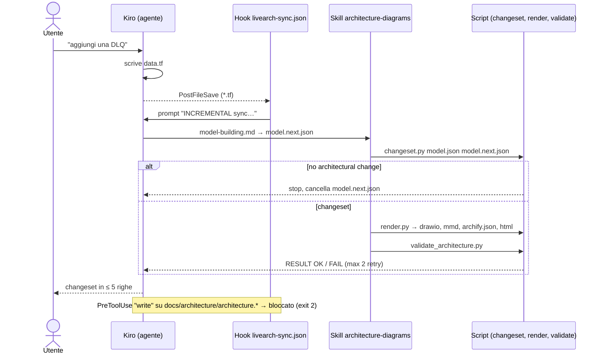

# Design: Live sync

## Overview
SYNC non aggiunge logica di dominio: orchestra ING, MOD e REN dentro il repo dell'utente e ne garantisce le
proprietà operative (incrementale, atomica, protetta, read-only sull'IaC). Ha due modalità:

| Modalità | Chi la avvia | Esiste oggi |
|----------|--------------|-------------|
| **Agent-driven** | hook `livearch-sync-on-iac-change` (PostFileSave) → skill `architecture-diagrams` | sì |
| **Watch** | tool MCP `watch` del server `livearch` (file watcher + debounce) | no, SYNC-6.2/6.3 |

## Architecture



## Components and interfaces

File installati nel repo IaC (asset dello skill `setup-live-sync`):

| Asset | Destinazione | Contenuto |
|-------|--------------|-----------|
| `assets/livearch-sync.json` | `.kiro/hooks/livearch-sync.json` | `livearch-sync-on-iac-change` (PostFileSave, agent) + `livearch-block-manual-diagram-writes` (PreToolUse `write`, command) |
| `assets/livearch-steering.md` | `.kiro/steering/livearch.md` | regole della sessione (fileMatch su IaC e `docs/architecture/**`) |

Stato su disco in `docs/architecture/`:

```text
model.json              # modello corrente (committato)
model.next.json         # solo durante una sync; non esiste mai a sync terminata
architecture.drawio     # merge (REN-2)
architecture.mmd        # rigenerato
architecture.archify.json, architecture.html   # rigenerati
```

Tool MCP (futuro):

```ts
export interface WatchInput { root: string; outDir?: string; debounceMs?: number /* default 2000 */ }
export interface SyncReport { changeset: string[]; warnings: Warning[]; written: string[]; result: "OK" | "FAIL" | "PARSE_ERROR" | "NO_CHANGE" | "BUSY" }
// sync({ root, outDir? }): SyncReport            — parse_iac → build_model(previous) → render_diagrams → validate_diagrams (SYNC-8)
// watch(WatchInput): { watching: string[] }      — notifica MCP con un SyncReport per ogni ciclo (SYNC-6.4)
// unwatch({ root }): { stopped: boolean }
```

`sync` e `watch` condividono un lock in memoria per root (SYNC-8.2): il server è un processo stdio per sessione,
quindi non serve un lock su file.

## Data models
- Changeset e riepilogo: MOD-8 (`scripts/changeset.py`).
- Modello: `model.schema.json`. Report del validatore: REN-5.

## Error handling
| Situazione | Comportamento | Requisito |
|------------|---------------|-----------|
| IaC non analizzabile | nessun file toccato, `PARSE_ERROR <file>:<linea>` | SYNC-4.1 |
| Nessun cambio architetturale | `model.next.json` cancellato, nessun render | SYNC-3.2 |
| Validatore FAIL | correzione di `model.json`, max 2 retry, poi stop | SYNC-4.2 |
| Serve `init`/`plan`/`synth` | conferma esplicita, altrimenti dati esistenti + `STALE_SYNTH` | SYNC-4.3 |
| Scrittura manuale su un diagramma | bloccata dall'hook PreToolUse | SYNC-5.1 |
| Target dell'installazione già diverso | diff + `replace`/`keep`/`merge` | SYNC-1.4 |
| Repo pubblico | avviso e conferma | SYNC-1.5 |

L'atomicità viene dall'ordine delle operazioni: il modello nuovo vive in `model.next.json` finché parsing e changeset
non sono riusciti; i diagrammi si toccano solo dopo.

## Test strategy
- **Scenario demo** (manuale, documentato in `docs/context-map.md`): su una copia del golden, chiedere a Kiro
  "aggiungi una dead-letter queue": l'hook scatta, il changeset è quello di SYNC-3.5, il box spostato a mano resta fermo.
- **Hook di blocco**: alimentare il comando di `livearch-block-manual-diagram-writes` con un JSON `tool_input` che
  scrive `docs/architecture/architecture.mmd` (atteso exit 2) e uno che scrive `docs/architecture/model.json` (atteso exit 0).
- **Idempotenza dell'installazione**: due esecuzioni di `setup-live-sync` su un repo di prova → seconda esecuzione senza modifiche.
- **Errori**: `.tf` con una graffa mancante → nessun file di `docs/architecture/` cambia (confronto degli hash).
- **Watch** (futuro): 10 salvataggi in 1 s → una sola sync; un render non riavvia la sync.

## Decisions
- **D-SYNC-1 · L'hook delega all'agente, non a uno script.** Oggi la costruzione del modello è dell'agente (lo script
  arriverà con il server MCP); l'hook dà un prompt preciso e gli script deterministici verificano.
- **D-SYNC-2 · Blocco delle scritture invece di fiducia.** Un'istruzione nello steering può essere ignorata, un hook
  PreToolUse con exit 2 no.
- **D-SYNC-3 · `model.next.json` come staging.** Rende la sync annullabile senza git e senza file temporanei fuori dal repo.
- **D-SYNC-4 · Limite dichiarato, non nascosto.** Gli hook di Kiro non vedono le modifiche fatte nell'editor
  dall'utente: lo si dice all'installazione (SYNC-6.1) e lo risolve la modalità watch.

## Traceability
| Requisito | Componente | Test |
|-----------|------------|------|
| SYNC-1 | skill `setup-live-sync` | idempotenza dell'installazione |
| SYNC-2 | `livearch-sync-on-iac-change` | scenario demo, matcher |
| SYNC-3 | skill `architecture-diagrams` §§ 2–6, `changeset.py` | scenario demo (SYNC-3.5) |
| SYNC-4 | skill `architecture-diagrams` (hard rules, § 5) | `.tf` rotto |
| SYNC-5 | `livearch-block-manual-diagram-writes` | test dell'hook |
| SYNC-6 | `setup-live-sync` step 6, tool `watch` | test del debounce |
| SYNC-7 | `setup-live-sync` § Uninstall | manuale |
| SYNC-8 | `mcp/src/sync/sync.ts` (tool `sync`) | `sync.test.ts` |
