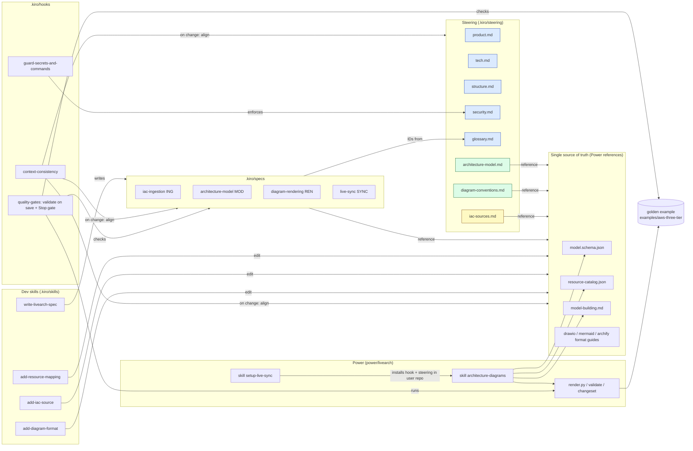

# Context map: how the Kiro artifacts work together

LiveArch is a context project: every rule exists **once**, and each artifact has a single job.
**Steering** says *why and what*, **specs** say *what exactly to build*, **skills** say *how to do it step by step*,
**hooks** *verify it automatically*, and **scripts** do the deterministic work.

Legend: blue = `inclusion: always`, green = `fileMatch`, yellow = `auto`.

## Two audiences, two layers
| Layer | Used by | Where |
|-------|---------|-------|
| **Building LiveArch** | Kiro working on this repo | `.kiro/steering`, `.kiro/specs`, `.kiro/skills`, `.kiro/hooks` |
| **Using LiveArch** | Kiro working on *your* IaC repo | `power/livearch` (skills, references, scripts), plus the hook and steering that `setup-live-sync` installs |

## Traceability matrix
Every rule has one owner and is applied, specified and checked by named artifacts.

| Rule / concern | Owner (source of truth) | Steering | Spec | Applied by (skill) | Checked by (hook / script) |
|----------------|-------------------------|----------|------|--------------------|----------------------------|
| IaC detection and parsing | `model-building.md` § Detection, Step 1 | `iac-sources.md` | ING-1…ING-8 | `architecture-diagrams` §1–2, `add-iac-source` | Stop gate (golden example) |
| Type → kind → notation | `resource-catalog.json` | `architecture-model.md` | MOD-2, REN-1.5 | `add-resource-mapping` | `catalog-or-schema-changed`, `validate --catalog` |
| Model contract | `model.schema.json` | `architecture-model.md` | MOD-1, MOD-3 | `architecture-diagrams` §2 | `validate_architecture.py` `check_model` |
| Groups and edges | `model-building.md` Step 4–5 | `architecture-model.md` | MOD-5, MOD-6, MOD-9 | `architecture-diagrams` §2 | golden example, `design-rules-changed` |
| Three consistent views | format guides in `references/` | `diagram-conventions.md` | REN-1…REN-5 | `architecture-diagrams` §4–5, `add-diagram-format` | `validate-golden-example-on-save`, Stop gate (idempotency) |
| Hand layout survives | `drawio-format.md` | `diagram-conventions.md` | REN-2, SYNC-3.5 | `architecture-diagrams` §4 | Stop gate, demo step 4 |
| Live sync | `setup-live-sync` assets | `product.md` | SYNC-1…SYNC-8 | `setup-live-sync`, `architecture-diagrams` | installed `livearch-sync.json` |
| Generated files are read-only | installed hook | `diagram-conventions.md` | SYNC-5 | `architecture-diagrams` (hard rule) | `livearch-block-manual-diagram-writes` |
| Secrets and dangerous commands | `security.md` | `security.md` | ING-6, MOD-7, REN-5.3, SYNC-4.3 | all skills (hard rules) | `guard-secrets-and-commands`, `check_secrets` |
| Spec quality | `write-livearch-spec` | `glossary.md` (prefixes) | all | `write-livearch-spec` | `spec-traceability`, Stop gate |

Spec status: the agent-driven pipeline (skills + Python scripts) is implemented and its tasks are ticked in MOD, REN and SYNC; the
`livearch` MCP server (`detect_sources`, `parse_iac`, `build_model`, `render_diagrams`, `validate_diagrams`, `watch`)
is specified but not built yet.

## Context decisions
| Decision | Why |
|----------|-----|
| One canonical model, three renderers | consistency across formats is checkable, and a new format is a new renderer |
| Rules in the Power's `references/`, steering only references them | the Power must be self-contained for users, and there are no duplicate truths |
| Only the 5 core steering files are `always`; domain files use `fileMatch`/`auto` | small context in every session, depth when it matters |
| LLM builds the model, scripts draw and validate | judgement where it is needed, determinism where it matters (PR diffs, layout preservation) |
| Stop hook blocks the turn on broken catalog, golden example, idempotency or traceability | Kiro cannot "finish" with an inconsistent context |
| PreToolUse guard on shell and write | security.md is enforced by code, not by a promise |
| EARS + prefixed IDs + traceability script | each requirement is testable and each criterion has a task |

## Demo script (5 min)
1. **Context**: show this map, then `product.md` and the catalog (one entry = one AWS service).
2. **Generate**: "Draw the architecture of `examples/aws-three-tier`". The Power activates on keywords and runs the
   `architecture-diagrams` skill, producing 3 files plus a validation OK.
3. **Live change**: ask Kiro to "add an SNS topic that notifies the order worker" in `worker.tf`. The `PostFileSave`
   hook fires, the sync runs, and the 5-line changeset shows `added: node aws_sns_topic…, edge …trigger…`.
4. **Human layout survives**: move a box in draw.io, sync again, and the box stays where you put it.
5. **Guardrails**: ask Kiro to "deploy it with terraform apply", and the guard blocks it. Ask it to "edit the drawio
   directly", and the Power hook blocks that too.
6. **Extensibility**: "support EFS". The `add-resource-mapping` skill runs, and the catalog-changed hook bumps the
   version, aligns the docs and re-validates.
