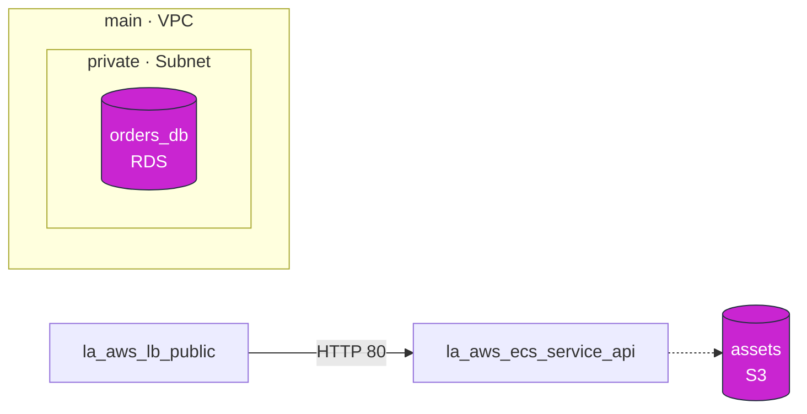

# Mermaid format (LiveArch)

`architecture.mmd` is **always regenerated in full** and never merged. GitHub renders it in Markdown.
Reference implementation: `../scripts/render.py`.

## Structure, in this exact order

1. Two header comments: the generator, then the catalog version and the first 12 chars of the model's sha256.
2. `flowchart LR`.
3. Nested `subgraph` blocks for groups, ordered by id. Inside each one: its nodes ordered by id, then its child subgraphs.
4. Top-level nodes (`group: null`), ordered by id.
5. Edges, ordered by edge id.
6. `classDef` lines, ordered by class name, then the `class` assignments in the same order.

## Shapes (`kinds[kind].mermaid.shape`)
| shape | syntax |
|-------|--------|
| rect | `id["…"]` |
| rounded | `id("…")` |
| stadium | `id(["…"])` |
| subroutine | `id[["…"]]` |
| cylinder | `id[("…")]` |
| hexagon | `id{{"…"}}` |

## Arrows (`edgeKinds[kind].mermaid`)
`network-flow` `-->`, `trigger` `==>`, `data-access` `-.->`, `depends-on` `---`. A label goes in `|"…"|` right after the arrow.

## Escaping
Labels are always in double quotes; `"` becomes `#quot;`. Line break: ` `. IDs contain only `[A-Za-z0-9_]`.

## Class colours
Class = `kinds[kind].mermaid.class`; `fill` = the `drawio.fillColor` of the first kind (alphabetical order) with that class.
